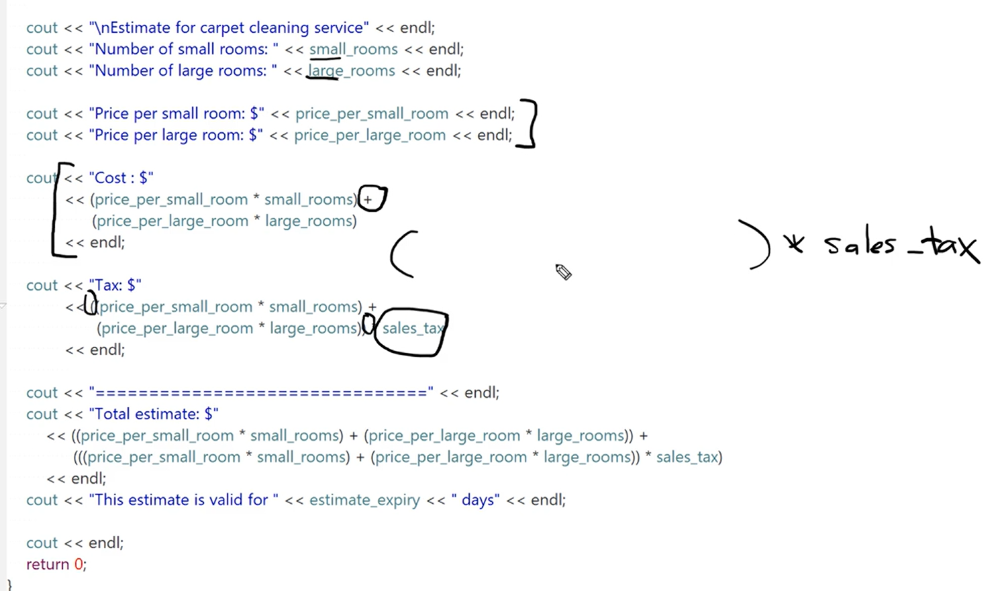

# Variables and Constants

## What Is a Variable?

At an introductory level, a variable can be viewed as a meaningful name for a value stored by a program. More precisely, a variable is introduced by a declaration and has a type, a scope, and a lifetime. Most variables name objects, while some variables are references that provide another name for an existing object.

A variable's **type** determines:

- which values it can represent;
- which operations are valid;
- how its value is interpreted; and
- often, but not always by itself, its size and alignment requirements.

A variable's **value** is its current state, such as `2`, `3.14`, `"Hello"`, or a user-defined `Account` object. A non-`const` object's value may change during its lifetime.

Variables let programmers reason with domain names such as `room_count` instead of manually tracking machine addresses. They must be declared before a use that requires their declaration to be visible.

### Connection to Assembly

As a useful assembly-language analogy, a label can identify an address in a data section such as `.data` or `.bss`, depending on the assembler and object-file format. Instructions can then read or write the storage associated with that address.

C++ variables are a higher-level abstraction. The compiler may place an object in memory, keep a value in a register, optimize it away, or transform its representation, provided the program's permitted observable behavior is preserved.

> [!NOTE]
> **How the sausage is made: a variable is not always a fixed memory slot**
>
> Source code describes values, objects, and their lifetimes. During optimization, the compiler can avoid assigning a stable address to a variable whose address is never observably needed. Taking an object's address, declaring it `volatile`, or crossing certain function boundaries can constrain those choices.

## Declaring, Initializing, and Assigning Variables

A declaration introduces a name and describes its type:

```cpp
int dogs;
```

For a local automatic variable of fundamental type, this declaration performs default-initialization and does not supply an initial numeric value. Do not read `dogs` before giving it a value.

Assignment changes the value of an object that already exists:

```cpp
int dogs;
dogs = 5;
```

Initialization supplies an initial value as the object is created:

```cpp
int dogs = 5;
```

These operations are related but not interchangeable: initialization constructs an object, while assignment modifies an existing object.

### Common Initialization Forms

```cpp
int dogs = 5; // Copy-initialization
int cats(3);  // Direct-initialization
int birds{21}; // Direct-list-initialization
```

Braced list-initialization is often a useful default because it rejects many narrowing conversions:

```cpp
int exact{5};       // Valid
// int narrowed{5.7}; // Error: narrowing from double to int
```

This protection also matters for floating-point types. A literal such as `0.06` has type `double`, so use `double tax_rate{0.06};` or, when `float` is specifically required, use the `f` suffix: `float tax_rate{0.06f};`.

### Naming Variables

Basic identifiers can contain letters, digits, and underscores, but cannot begin with a digit or be a C++ keyword. Identifiers are case-sensitive.

- Follow one naming convention consistently.
- Choose names that communicate purpose and units.
- Initialize variables before reading their values.
- Declare a variable close to its first use.
- Avoid shadowing and unnecessary reuse of names.
- Avoid implementation-reserved identifiers, including names containing `__` and names beginning with an underscore followed by an uppercase letter.

A name generally cannot be redeclared as a different entity in the same scope, although C++ has specific exceptions such as compatible repeated declarations of the same function.

## Global Variables

What programmers call a **global variable** is usually a variable declared at namespace scope. Such an object has static storage duration: its lifetime spans the program. If no other initializer supplies its value, it is zero-initialized before `main` begins.

Whether another function or source file can name that object also depends on scope, linkage, and the declarations visible at the point of use. Being global does not automatically make a name visible everywhere.

Mutable global state can be changed by distant code, making dependencies, testing, concurrency, and debugging harder to reason about. Prefer local variables and explicit function parameters when they express the design clearly.

This local variable exists only during the execution of `main` and can be named only within its scope:

```cpp
#include <iostream>

int main() {
    int local_variable{10};
    std::cout << "Local variable: " << local_variable << '\n';
    return 0;
}
```

A namespace-scope variable can be named from functions where its declaration is visible:

```cpp
#include <iostream>

int age{18};

int main() {
    std::cout << "Global variable: " << age << '\n';
    return 0;
}
```

A declaration in an inner scope can **shadow** a declaration with the same name in an outer scope:

```cpp
#include <iostream>

int age{18};

int main() {
    int age{16};
    std::cout << "Local variable: " << age << '\n'; // Prints 16.
    std::cout << "Global variable: " << ::age << '\n'; // Prints 18.
    return 0;
}
```

Within `main`, unqualified `age` names the local object. The qualified name `::age` explicitly selects the global namespace. Although legal, shadowing can obscure which object is being used and is usually best avoided.

## C++ Fundamental Types

The C++ standard calls the types built into the language **fundamental types**. Their exact sizes are implementation-dependent, subject to minimum ranges and ordering requirements. Query the active implementation instead of assuming that every platform uses the same data model.

### Character Types

- `char` occupies exactly one C++ byte. A byte contains at least 8 bits, and `CHAR_BIT` reports the actual number.
- `signed char` and `unsigned char` are distinct integer types that can represent individual bytes.
- `char8_t` represents UTF-8 code units in C++20 and later.
- `char16_t` represents 16-bit Unicode code units, commonly used by UTF-16.
- `char32_t` represents 32-bit Unicode code units, commonly used by UTF-32.
- `wchar_t` is an implementation-defined wide-character type. It is commonly 16 bits on Windows and 32 bits on many Unix-like systems.

A code unit is not always a complete user-perceived character. For example, one Unicode character may require a pair of UTF-16 code units or a sequence of UTF-8 code units.

### Integer Types

The standard integer families are `short`, `int`, `long`, and `long long`. The keyword `int` is optional in forms such as `short int` and `long int`.

| Type | Minimum width | Notes |
|---|---:|---|
| `short` | 16 bits | No wider than `int` |
| `int` | 16 bits | Usually the natural integer type for the platform |
| `long` | 32 bits | 32 bits in 64-bit MSVC; commonly 64 bits on 64-bit Linux |
| `long long` | 64 bits | At least as wide as `long` |

Each family has signed and unsigned forms:

- Signed types represent negative, zero, and positive values.
- Unsigned types represent zero and positive values and use modulo-$2^N$ arithmetic for an $N$-bit type.

Unsigned does not mean "positive only" because zero is included.

Use `sizeof` and `std::numeric_limits<T>` when code or notes need facts about the current implementation. Fixed-width aliases such as `std::int32_t` and `std::uint32_t` are available from `<cstdint>` when the implementation provides a type with exactly that width.

### Integer Promotions and Division

Before many arithmetic operations, integer types narrower than `int`, such as most `short` values, are promoted to `int`. The result is not automatically promoted to floating point:

```cpp
short numerator{7};
short denominator{2};

auto integer_result = numerator / denominator; // int with value 3
double real_result = static_cast<double>(numerator) / denominator; // 3.5
```

When both operands of `/` are integers, C++ performs integer division and truncates the fractional part toward zero. If either operand is floating point, the usual arithmetic conversions produce floating-point division.

### Floating-Point Types

Floating-point values are commonly represented with a sign, significand, and exponent. Their size, range, precision, and representation are implementation-dependent.

| Type | Typical precision | Common implementation |
|---|---:|---|
| `float` | About 6-7 decimal digits | IEEE 754 binary32, usually 32 bits |
| `double` | About 15-16 decimal digits | IEEE 754 binary64, usually 64 bits |
| `long double` | At least as much as `double` | Varies; MSVC commonly treats it like `double` |

Use `std::numeric_limits<T>` from `<limits>` for authoritative values such as `digits10`, `lowest()`, and `max()` on the current toolchain.

Floating-point values approximate most decimal fractions. For example, `0.1` usually cannot be represented exactly in a binary floating-point type.

### Boolean Type

`bool` represents the values `false` and `true`. In conversions to `bool`, zero becomes `false` and nonzero numeric values become `true`. In conversions from `bool` to an integer type, `false` becomes `0` and `true` becomes `1`.

`sizeof(bool)` is implementation-defined and is commonly one byte; that does not imply that every stored Boolean necessarily consumes a separately addressable byte in optimized or packed representations.

### Overflow, Narrowing, and Wraparound

The original multiplication example needs three separate concepts:

```cpp
short value1{30000};
short value2{1000};

// The operands promote to int, so the multiplication produces int 30000000.
int product{value1 * value2};

// short narrowed{value1 * value2};
// Error: list-initialization rejects the narrowing conversion to short.
```

If an arithmetic operation exceeds the range of its **signed result type**, the behavior is undefined; signed overflow is not guaranteed to wrap:

```cpp
#include <limits>

int maximum{std::numeric_limits<int>::max()};
// int invalid{maximum + 1}; // Undefined behavior if evaluated.
```

Unsigned arithmetic wraps modulo $2^N$ and is well-defined:

```cpp
#include <limits>

unsigned int maximum{std::numeric_limits<unsigned int>::max()};
unsigned int wrapped{maximum + 1}; // 0
```

> [!WARNING]
> **How the sausage is made: a familiar wrapped result is not a C++ guarantee for signed overflow**
>
> Hardware often uses two's-complement arithmetic, but an optimizing compiler may assume that a valid C++ program does not execute signed overflow. That assumption permits transformations that make the observed result differ from a simple hardware wrap. Use a sufficiently wide type, validate before arithmetic, or intentionally use unsigned modular arithmetic when wraparound is part of the design.

## The `sizeof` Operator

`sizeof` reports the storage size of a type or expression in C++ bytes. Its result has type `std::size_t` and is a compile-time constant expression for standard C++ types.

```cpp
int my_variable{0};

sizeof(int);         // Parentheses are required around a type name.
sizeof(double);
sizeof(my_variable); // Parentheses are optional around an expression.
sizeof my_variable;
```

No header is required to use the built-in `sizeof` operator. The headers `<climits>` and `<cfloat>` provide implementation limits, while the C++ `<limits>` header provides the typed `std::numeric_limits` interface.

Except in special nonstandard extensions, the operand expression is not evaluated:

```cpp
int value{5};
auto bytes = sizeof(value++); // value remains 5
```

`sizeof(char)` is always `1`. This means one C++ byte, not necessarily eight bits; use `CHAR_BIT` from `<climits>` when the number of bits matters.

## What Is a Constant?

A constant represents a value that the program is not permitted to modify through the relevant name or expression. Named constants improve readability, prevent accidental mutation, and provide one authoritative place for a value used repeatedly.

Not every source-level constant must occupy storage. The compiler may embed a value directly or eliminate an object under the as-if rule when its identity and address are not observably required.

### Literal Values

Literals are values written directly in source code:

```cpp
42          // int literal
3.14        // double literal
3.14f       // float literal
'A'         // char literal
"Hello"     // string literal: array of const char
true        // bool literal
```

Literal suffixes affect type. This is particularly important with braced initialization because `float rate{0.06};` attempts a narrowing conversion from a `double` literal, while `float rate{0.06f};` uses a `float` literal.

### `const` Objects

`const` prevents modification through that object after initialization:

```cpp
const int max_users{100};
```

A `const` value is not automatically a compile-time constant in every context. It may be initialized from a runtime value:

```cpp
int read_limit();
const int limit{read_limit()}; // Immutable after initialization, but runtime-derived.
```

### `constexpr` Objects

`constexpr` declares that an object can participate in constant evaluation and requires a compile-time-valid initializer:

```cpp
constexpr int max_size{10 * 2};
```

A `constexpr` object is also `const`. Prefer `constexpr` when a value is inherently compile-time data and `const` when a value is determined at runtime but should not change afterward.

### Enumeration Constants

Enumerations represent a fixed set of related named values. A scoped enumeration avoids implicitly placing its enumerator names into the surrounding scope:

```cpp
enum class Color {
    red,
    green,
    blue
};

Color selected{Color::green};
```

### Macro Replacements

A preprocessor macro can replace tokens before compilation:

```cpp
#define PI 3.14159
```

This is not a typed C++ constant. For ordinary constants, prefer a scoped, typed language feature:

```cpp
inline constexpr double pi{3.14159};
```

Macros remain useful when preprocessing itself is required, such as conditional compilation or token stringizing.

### Escape Sequences in Character and String Literals

| Escape | Meaning |
|---|---|
| `\n` | newline |
| `\r` | carriage return |
| `\t` | horizontal tab |
| `\b` | backspace |
| `\'` | single quote |
| `\"` | double quote |
| `\\` | backslash |
| `\0` | null character |

An escape sequence represents a character within a character or string literal; it is not a separate category of constant.

> [!NOTE]
> **How the sausage is made: `const` is a rule, not necessarily a ROM location**
>
> `const` controls which modifications are permitted through the C++ type system. It does not by itself require an object to reside in read-only hardware or a particular executable section. Placement depends on storage duration, initialization, whether the address is needed, the target platform, and compiler optimization.

## Section Challenge

The supplied course solution is shown below:



Your implementation is in [VariablesAndConstants/main.cpp](VariablesAndConstants/main.cpp).

### Solution Comparison

| Area | Your solution | Supplied solution |
|---|---|---|
| Core calculation | Correct subtotal, tax, and total formulas | Correct formulas |
| Reuse of calculations | Stores the subtotal, tax, and total, avoiding repeated formulas | Repeats the cost expression in several output statements |
| Constants | Declares prices, tax rate, and validity period as constants | Declares prices, tax rate, and validity period as constants |
| Numeric types | Consistently uses `float` variables with `f`-suffixed literals, so the list-initializations do not narrow | Uses `double`, which provides more precision and is the usual default floating-point type |
| Output correctness | Labels room counts and currency values correctly; currency is not forced to two decimal places | Labels and currency placement are correct; currency is not forced to two decimal places |
| Readability | Descriptive variables and a clear top-to-bottom calculation; indentation, spacing, and a few names need cleanup | Consistent layout, though its repeated expressions are harder to maintain |
| Robustness | Initializes inputs, but does not detect failed input or negative room counts | Also omits input validation at this stage of the course |

### Rating

**Your solution: 8.5/10**

The algorithm and displayed values are correct, all fixed pricing values are constant, the `float` literals match their destination types, and the named subtotal, tax, and total avoid the supplied solution's repeated arithmetic. The remaining deductions are for vague or singular names such as `cost` and `validDay`, indentation and spacing, repeated flushing with `std::endl`, default rather than fixed currency precision, and the lack of input validation.

**Supplied solution: 8/10**

It better demonstrates the section's lesson by using constants and suitable `double` values, and its output follows the requested format more closely. It still repeats calculations, uses `using namespace std;`, performs no input validation, and does not format currency to exactly two decimal places.

### Highest-Value Improvements to Your Solution

1. Rename `cost` to `totalEstimate` and `validDay` to `estimateValidityDays`.
2. Consider `constexpr` for values known at compile time and `double` as the default floating-point type for this exercise.
3. Apply consistent indentation and spacing.
4. Prefer `\n` for routine line endings and reserve `std::endl` for intentional flushing.
5. Format currency with `std::fixed` and `std::setprecision(2)` once `<iomanip>` is introduced.
6. Later, validate extraction success and reject negative room counts.